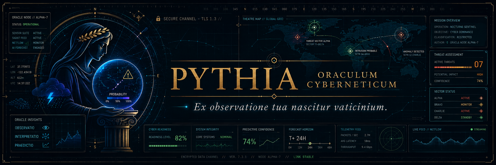

# PYTHIA — サイバー戦術予報士

<p align="center">
  
</p>

> 神託は、あなたの観測から生まれる。

PYTHIA は、サイバー脅威の「天気予報士」です。
日々の観測データから脅威の傾向を読み取り、**確度付きのサイバー攻撃予報**を生成し、
その予報を実績と突き合わせる**検証ループ**で精度を継続的に改善していきます。

デルフォイの神殿でアポロンの神託を告げたピュティアは、未来を断言せず、
観測と解釈を組み合わせた確率的な神託を告げました。
不確実な未来を「確度付きの予測」として語る——それがこのツールの本質です。

---

## このリポジトリの主役は「予報」である

```
                    ┌─────────────────────────────────────┐
                    │   PYTHIA = サイバー攻撃予報の生成     │  ← 目的（主役）
                    └─────────────────────────────────────┘
                                     ▲
                          予報の精度を高めるために
                                     │
   ┌─────────────────────────────────┼─────────────────────────────────┐
   │                                 │                                 │
日々の観測データ供給              検証ループ                      過去からの学習
（日次セキュリティ            （予報 × 実績の突合）        （バックフィル・較正統計・
  インテリジェンス収集）              │                       類似過去事例検索）
   │                                 │                                 │
CVE / APT / AI攻撃 /          的中率の記録と               KEV・CISA勧告・ATT&CK 等の
トレンドを収集・正規化して     knowledge 補正の提案          一次記録から過去実測を取り込み
Pythia の「観測」にする      （人間レビュー経由で反映）      予報の確度を較正する
   └─────────────────────────────────┴─────────────────────────────────┘
```

日次のセキュリティインテリジェンス収集（CVE・APT・AI攻撃・トレンド）は、
それ自体が目的ではなく、**Pythia に予報の材料となる観測データを供給するための作業**です。
収集した情報は ATT&CK 正規化を経て observation となり、ベースラインと突き合わされ、予報の根拠になります。

**検証ループが回り始めた日が、Pythia の誕生日です。**

---

## 設計思想（3つの核心原則）

1. **構造化が先、量は後** — 収集量ではなく、正規化スキーマと検証ループが精度を決める。
2. **Git が記憶装置** — Claude はセッションをまたいで記憶しない。すべての観測・予報・検証をコミットすることで、リポジトリの履歴が Pythia の長期記憶になる。
3. **検証ループが精度を生む** — 「予報 → 実績突合 → 補正 → 再予報」のループが回ることが精度の源泉。蓄積量は必要条件ではない。

---

## Pythia の中核：4ステージ予報パイプライン

予報生成の心臓部は `forecaster/` にある。

```
[日次収集] 観測材料の取得（CVE/APT/AI攻撃/トレンド）
    ↓
[01 正規化]   ATT&CK スキーマに沿って observation 化（source_explicit_all モード）
    ↓ forecaster/observations/ にコミット
[02 ベースライン] 平常状態の統計を更新（TTP頻度・グループ活性度）
    ↓ forecaster/baseline/ にコミット
[03 予報生成]  ベースライン逸脱・knowledge・類似過去事例から確度付き予報を生成
    ↓ forecaster/forecasts/daily/ にコミット（Markdown + JSON サイドカー）
[04 検証]      過去の予報を実観測と突合し的中率を記録、knowledge補正を提案
    ↓ forecaster/verification/ を更新 → PR 発行（main へ直接コミットしない）
    ↓
[人間レビュー] 検証PR・補正提案をマージ → knowledge/ が育つ → 次サイクルで精度が上がる
```

| ステージ | 実行タイミング | 出力 | プロンプト |
|----------|--------------|------|-----------|
| 01 正規化 | 日次（収集後） | `forecaster/observations/YYYY/MM/YYYY-MM-DD.json` | `forecaster/prompts/01-normalize.md` |
| 02 ベースライン | 日次（01後） | `forecaster/baseline/*.json` | `forecaster/prompts/02-baseline.md` |
| 03 予報生成 | 日次（02後） | `forecaster/forecasts/daily/YYYY-MM-DD.md` + `.json` | `forecaster/prompts/03-forecast.md` |
| 04 検証 | 週2回（火・木 12:00 JST） | `forecaster/verification/YYYY-MM.json` ほか（PR経由） | `forecaster/prompts/04-verify.md` |

### 予報の判定ロジック（03 予報生成の内部ステップ）

| ステップ | 内容 |
|---|---|
| Step A' | KEV登録・実確認イベント起点の予報 |
| Step A | Technique 逸脱スコアの算出（ベースライン比較） |
| Step B | グループ活性化の判定 |
| Step C | 次段階TTP予測 + `attack-group-history.json` によるレパートリー照合（降格方向優先） |
| Step C' | 認証情報・トークン連鎖予報 |
| Step C'' | 類似過去事例の想起 — 内部の検証済み実績を `scripts/retrieve_similar_cases.py` で検索（Case-Based Retrieval） |
| Step C''' | 外部類似事案の参照 — CERT/ベンダー/CISA 等の一次出典付き過去事案 |
| Step D | 予報の絞り込みと Tier 判定 |

予報は品質ルール **M1〜M4**（`pipeline-forecast-verification.md`）に準拠する:
M1 観測可能性ゲート（的中条件を観測出口クラス E1〜E4 に限定）/ M2 検証窓の分離（fast_72h / slow_7d）/
M3 EPSS+SSVC 確度アンカー / M4 KEVスナップショット記録。

> Pythia の構造・育て方の詳細は [`forecaster/README.md`](forecaster/README.md) を参照。
> Case-Based Retrieval の設計は [`forecaster/case-based-retrieval-design.md`](forecaster/case-based-retrieval-design.md) を参照。

---

## 観測データを供給する：日次セキュリティインテリジェンス収集

Pythia の予報精度は観測データの質に依存する。
そのため、毎日 CVE・APT 活動・AI 攻撃動向・SOC 推奨情報を収集・重みづけし、
正規化の入力となる構造化レポートを生成する。

```
Step 0    時刻確認・調査期間確定（前日 07:00 JST 〜 当日 07:00 JST）

Step 0.5  機械収集データの読み込み（一次入力）
           └─ security-intel-collector/data/raw/ の機械収集済み JSON を調査起点にする
              news-*.json（RSS記事）/ cves-*.json（記事から抽出したCVE言及）
              （Web 検索は不足分の補完のみ — 再現性確保のため）

Step 1    情報収集（3トラック並行）
           ├─ Step 1:  CVE調査    — NVD / CISA KEV / GitHub Advisory / ベンダー
           │            （トラックA/B 排他的決定木で帰属判定・固定の製品リストは持たない）
           ├─ Step 1b: APT活動    — Mandiant / MSTIC / CrowdStrike / Unit 42 / CISA合同勧告
           └─ Step 1c: AI攻撃     — MITRE ATLAS / OWASP GenAI / arXiv / AI Incident DB

Step 2    動向収集
           ├─ 英語ソース: BleepingComputer / The Hacker News / SecurityWeek 等
           └─ 日本語ソース（必須）: Security NEXT / JPCERT/CC / IPA / ScanNetSecurity 等

Step 3    重みづけ・スコアリング・出力（security-report.json + 5種テキスト）

Step 3.5  予報士システム連携 — 上記出力を 01 正規化 → 02 ベースライン → 03 予報 に投入

Step 4    ファイル更新・コミット（main へ直接コミット "daily report: YYYY-MM-DD"）
           └─ コミット前に機械的ガードを実行:
              check_reported.py / validate_observations.py / validate_forecasts.py /
              check_knowledge_untouched.py（knowledge/ 無変更の機械的確認）
```

収集レポートの構成（Section 1〜4）と出力ファイルは下記の通り。

| ファイル | 内容 | 主な用途 |
|---|---|---|
| `security-report.json` | Section 1〜4 全データ（構造化） | 正規化の入力・AI分析・機械処理 |
| `security-report.txt` | Section 1〜4 完全版 | 日次レビュー・共有 |
| `security-report-cve.txt` | Section 3: 製品別CVE | CVE担当 |
| `security-report-zeroday-trends.txt` | Section 2: ゼロデイ・トレンド | トレンド担当 |
| `security-report-ai.txt` | Section 1: AI攻撃動向 | AI担当 |
| `security-report-soc.txt` | Section 4: SOC推奨情報 | SOC担当 |

テキストファイルはすべてプレーンテキスト（Markdown記法なし）。

---

## 過去からの学習：バックフィル・較正統計・類似過去事例検索

日次収集だけでは母集団が小さい。そこで、日付スタンプ付きの一次記録から過去実測を
機械的に取り込み、予報の文脈付けと確度較正に使う。
いずれも **knowledge/ 自動書き換え禁止ルールの対象**であり、再生成は
**PR 提案 + 人間レビュー経由のみ**（日次ルーチンからは実行しない）。

### 観測のバックフィル（observations/ への遡及取り込み）

| スクリプト | 一次ソース | 内容 |
|---|---|---|
| `scripts/backfill_observations.py` | CISA KEV `dateAdded` | 日次ルーチン開始前の実悪用確認イベントを機械バックフィル |
| `scripts/backfill_cisa_advisories.py` | CISA AA勧告（Wayback経由） | 明示 ATT&CK テーブル・明示帰属を持つ過去APT事象を機械バックフィル |

- 対象は**観測のみ**。予報・検証の遡及生成は後知恵バイアスとなるため行わない
- `_normalization_mode: machine_backfill_*` でマーキングされ、**ベースライン統計からは除外**される
- Technique / actor の推測付与はしない（情報源の明示分のみ）

### 較正統計・過去分布（knowledge/ の機械生成ファイル）

| knowledge ファイル | 生成スクリプト | 用途と限界 |
|---|---|---|
| `kev-leadtime-stats.json` | `build_kev_leadtime_stats.py` | 「NVD公開→KEV追加」ラグ実測分布。E1検証窓・base_rate の参考（生存バイアスを `_limitations` に明記・hit_criteria 変更には使用禁止） |
| `epss-kev-calibration.json` | `build_epss_kev_calibration.py` | KEV追加**前日**時点の EPSS %ile 実測。M3確度アンカーの感度検証用（P(KEV\|EPSS高) の根拠には使用禁止） |
| `zeroday-itw-priors.json` | `build_zeroday_itw_priors.py` | Google Project Zero「0-day ITW」由来のゼロデイ過去分布（検知バイアス明記・予測確率の直接根拠には使用禁止） |
| `attack-group-history.json` | `build_attack_group_history.py` | MITRE ATT&CK 由来の追跡対象グループ既知TTP・過去キャンペーン（出典付き。観測への Technique/帰属付与根拠には使用禁止） |

### 類似過去事例検索（Case-Based Retrieval）

予報生成の Step C'' で、**内部の検証済み過去予報・観測**から類似事例を検索し、
「類似N件中 的中X・部分Y・外れZ」の経験的実績を予報に添える。

- 検索器: `scripts/retrieve_similar_cases.py`（読み取り専用・`product-categories.json` で製品カテゴリを抽象化）
- 較正: 検証ステージで `scripts/record_retrieval_calibration.py` が閾値/重み較正の一次データを
  `forecaster/verification/retrieval-calibration.json` へ増分追記する
- 設計書: `forecaster/case-based-retrieval-design.md`

---

## 自動実行

### Claude Code Routines（LLM処理の本体）

```
Claude Code Routines（クラウド）
  └─ 毎日 07:00 JST に自動起動
       └─ ルート SKILL.md を実行（収集 Step 0〜4 + 予報 Step 3.5）
            └─ outputs/ + forecaster/ に保存 → main へ直接コミット
  └─ 火曜・木曜 12:00 JST
       └─ .skills/forecast-verification/SKILL.md を実行（実体は forecaster/prompts/04-verify.md）
            └─ 的中率記録・キャリブレーション・knowledge補正提案
            └─ ブランチ verify/YYYY-MM-DD → main への PR を発行（直接コミットしない）
```

手動実行は Routines 画面の「Run」をクリック。

### GitHub Actions（LLMを使わない補助自動化）

LLM 処理（分析・予報・コミット）はすべて Routines が行う。
GitHub Actions は外部 API キー不要の補助タスクのみを担当する。

| ワークフロー | タイミング | 役割 |
|---|---|---|
| `.github/workflows/daily-pipeline.yml` | 06:00 JST（Routines の1時間前・日次1回） | RSS 機械収集 + 記事からの CVE 言及抽出（`security-intel-collector/watcher.py`）→ `data/raw/` へコミット |
| `.github/workflows/weekly-verify.yml` | 火・木 11:55 JST | 検証タスクの Issue 作成（リマインド） |
| `.github/workflows/daily-healthcheck.yml` | 09:00 JST（Routines の2時間後・日次1回） | 日次成果物（当日分・前日分）の有無を確認し、未実行なら Issue を起票。成果物が未マージ PR 上に存在する場合はマージ待ちとみなして起票せず翌日に再確認する。解決済みの `[Alert]` / `[Verify]` トラッキング Issue（bot 起票分のみ）は自動クローズする |

`GITHUB_TOKEN`（自動付与）のみで動作する。`NVD_API_KEY` は任意（レート制限緩和用）。

---

## リポジトリ構成

```
config.yml                          ← Pythia の個性を定義（スコープ・優先事項・フェーズ）
CLAUDE.md                           ← Claude Code への最上位指示書（Pythia の人格・行動原則）
SKILL.md                            ← 日次パイプラインの実体（Routines にファイルパス指定で登録）
.skills/forecast-verification/      ← 週次予報精度検証スキル（火・木 12:00 JST・PR経由）

forecaster/                         ← ★Pythia の中核：予報エンジン★
  README.md                         ← Pythia の育て方・Phaseロードマップ
  phase1-config.json                ← 現フェーズ設定（フォーカス: Lazarus Group）
  case-based-retrieval-design.md    ← 類似過去事例検索（Case-Based Retrieval）設計書
  schema/observation.schema.json    ← ATT&CK 正規化スキーマ
  knowledge/                        ← 知識ベース（自動書き換え禁止・更新は PR + 人間レビュー経由のみ）
                                       検証ループの補正提案と機械生成統計（較正統計・過去分布・
                                       グループ過去事例・製品カテゴリ辞書）で育つ
  observations/YYYY/MM/             ← 正規化済み観測データ（日次蓄積 + 機械バックフィル）
  baseline/                         ← TTP出現頻度・グループ活性度の平常統計（バックフィルは除外）
  forecasts/daily/                  ← 日次予報（Markdown + JSON サイドカー）
  verification/                     ← 予報 × 実績の突合記録（月次JSON・週次レポート・retrieval較正データ）
  prompts/01〜04.md                 ← 4ステージのプロンプト

scripts/                            ← 機械処理スクリプト
  検証ガード:  check_reported.py / validate_observations.py /
              validate_forecasts.py / check_knowledge_untouched.py
  予報支援:    retrieve_similar_cases.py（Step C''）/ record_retrieval_calibration.py /
              regen_baseline.py
  過去学習:    backfill_observations.py / backfill_cisa_advisories.py /
              build_attack_group_history.py / build_kev_leadtime_stats.py /
              build_epss_kev_calibration.py / build_zeroday_itw_priors.py（すべて PR 経由でのみ実行）

security-intel-collector/           ← RSS 機械収集・CVE言及抽出（GitHub Actions が毎朝 06:00 JST に watcher.py を実行）
  watcher.py / feeds.json / data/raw/（cve_watcher.py は NVD API 収集器・本リポジトリでは未スケジュール）

収集ルール（観測データ供給）:
  pipeline-1-cve.md                 ← CVE調査（トラックA/B排他的決定木・固定の製品リストなし）
  pipeline-1b-apt.md                ← APT活動調査
  pipeline-ai-1.md                  ← AI攻撃調査
  pipeline-2-trends.md              ← 動向収集
  pipeline-3-weighting.md           ← CVE/APT 重みづけ・出力テンプレート
  pipeline-ai-2.md                  ← AI攻撃 重みづけ・出力テンプレート
  pipeline-soc-recommend.md         ← SOC推奨情報 収集・出力ルール
  pipeline-report-modes.md          ← 出力ファイル定義・ゼロデイ特報テンプレート
  pipeline-output-schema.md         ← security-report.json スキーマ定義
  pipeline-forecast-verification.md ← 攻撃予報 品質・精度検証ルール（M1〜M4 の正典）

reported-cves.md / reported-apts.md / reported-ai-attacks.md  ← 既報リスト（重複除外用・構造化）
outputs/YYYY-MM-DD/                 ← 日次収集レポート（観測材料）
.github/workflows/                  ← 補助自動化（RSS/CVE収集・検証リマインド）
```

---

## Phase ロードマップ

| Phase | 期間 | 内容 |
|---|---|---|
| Phase 0 | Week 1 | ディレクトリ・スキーマ確定 ✅ 完了（2026-06-26） |
| **Phase 1** | **Week 2-13** | **Lazarus Group に絞り手動レビュー付きで正規化を検証 → 検証ループ稼働 ← 現在ここ** |
| Phase 2 | Week 13-21 | 業界別・地域別の脅威動向セクション追加 |
| Phase 3 | Week 21-29 | D3FEND 防御連携・推奨防御アクション自動付与 |
| Phase 4 | Week 29+ | 精度統計が揃い、外部発信の素材になる |

Phase 1 は当初 Week 2-8 だったが、完了条件「ベースライン 90日」の到達が最短 2026-09-13 のため
Week 13（〜2026-09 中旬）まで延長（2026-07-13・`forecaster/phase1-config.json` の `phase_extension` 参照）。

### Phase 1 完了条件（的中率の高さは問わない）

- 正規化カバレッジ: 収集情報の 80% 以上に TTP 付与
- ベースライン確立: 90日分の平常分布が算出済み
- 検証ループ稼働: 週次で的中率が記録されている

---

## 運用ルール（厳守事項）

予報の人格・行動原則は [`CLAUDE.md`](CLAUDE.md) に定義。要点は以下。

1. **ハルシネーション厳禁** — ATT&CK Technique の紐付けは確証がある場合のみ。不能なら `techniques: []` + `confidence: low`。
2. **事実と推測の分離** — 観測（事実）と予測（推測）を必ず区別し、推測には「（推測）」を明記。
3. **帰属判断は慎重に** — actor_group は情報源が明示する場合のみ。TTP 類似だけで断定しない。
4. **verified_outcome は検証ステージ（04）のみが書き込む** — 正規化・予報段階では埋めない。
5. **knowledge/ の自動書き換え禁止** — 補正は Issue/PR で提案し、人間レビューを経てマージ。日次コミット前に `scripts/check_knowledge_untouched.py` が機械的に無変更を確認する。
6. **全変更をコミット** — 観測・予報・検証はすべて Git 履歴に残す。

### 設計上の禁止事項（守らないと精度が下がる方向に育つ）

| 禁止事項 | 理由 |
|---|---|
| knowledge/ を自動書き換えさせる | 誤った補正が蓄積して劣化する |
| verified_outcome を正規化時に埋める | 検証ループが機能しなくなる |
| 的中率を初期から求める | 記録と改善が止まる |
| 帰属不明な情報に actor_group を推測記入 | 知識ベースが汚染される |
| ベースライン未確立のまま定量スコアを予報根拠にする | 比較基準がなく予報が無意味になる |
| 予報・検証を過去日付で遡及生成する | 後知恵バイアスが検証ループを汚染する |
| 機械バックフィル観測をベースライン統計に混ぜる | 観測密度が異なり σ 逸脱スコアが歪む |
| 較正統計を hit_criteria の変更・確度引き上げの根拠にする | 生存バイアス・検知バイアスを含む条件付き分布のため |

---

## コミットルール

| ケース | ブランチ | PR |
|---|---|---|
| 日次予報・収集レポート | main へ直接コミット（`daily report: YYYY-MM-DD`） | 不要 |
| RSS/CVE 機械収集（GitHub Actions） | main へ直接コミット（`collect: rss feeds YYYY-MM-DD`） | 不要 |
| 検証結果 | `verify/YYYY-MM-DD` ブランチ（`forecast verification: YYYY-MM-DD`） | **必須**（人間レビュー） |
| knowledge 補正・機械生成統計の再生成 | Issue/PR で提案 | **必須**（人間レビュー） |

---

## ファイルを編集したい場合

| 目的 | 編集ファイル |
|---|---|
| Pythia のスコープ・優先事項・フェーズ | `config.yml` / `forecaster/phase1-config.json` |
| Pythia の人格・行動原則 | `CLAUDE.md` |
| 正規化ルール | `forecaster/prompts/01-normalize.md` |
| ベースライン算出ロジック | `forecaster/prompts/02-baseline.md` |
| 予報生成ロジック | `forecaster/prompts/03-forecast.md` |
| 検証ロジック | `forecaster/prompts/04-verify.md` |
| 予報の品質ルール（M1〜M4・的中判定） | `pipeline-forecast-verification.md` |
| CVE の採用基準（トラックA/B決定木） | `pipeline-1-cve.md` |
| APT追跡対象の変更 | `pipeline-1b-apt.md` / `forecaster/knowledge/group-aliases.json`（PR経由） |
| 収集の重みづけ基準 | `pipeline-3-weighting.md` |
| 収集の出力テンプレート | `pipeline-3-weighting.md` / `pipeline-ai-2.md` / `pipeline-soc-recommend.md` |
| 収集の JSONスキーマ | `pipeline-output-schema.md` |
| RSSフィードの追加・変更 | `security-intel-collector/feeds.json` |
| 類似過去事例検索の閾値・重み | `forecaster/case-based-retrieval-design.md`（設計）+ `scripts/retrieve_similar_cases.py` |
| パイプライン実行手順 | `SKILL.md`（日次）/ `.skills/forecast-verification/SKILL.md`（週次検証） |
